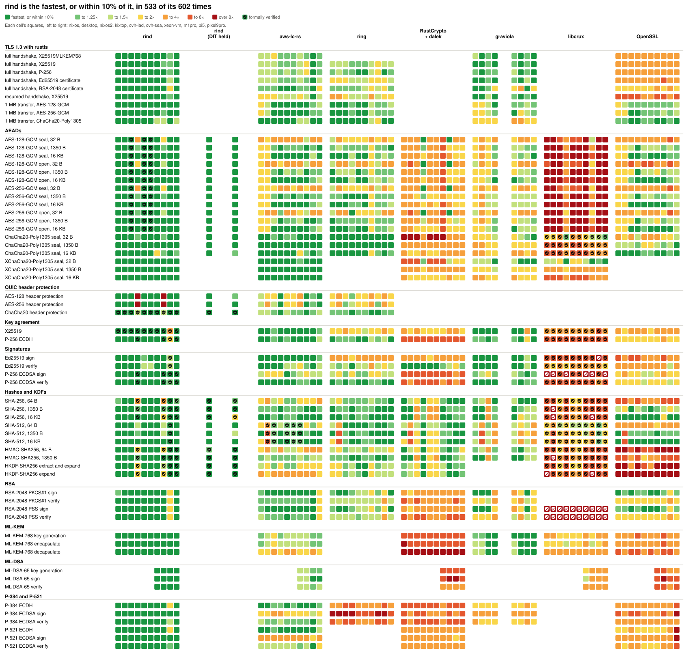
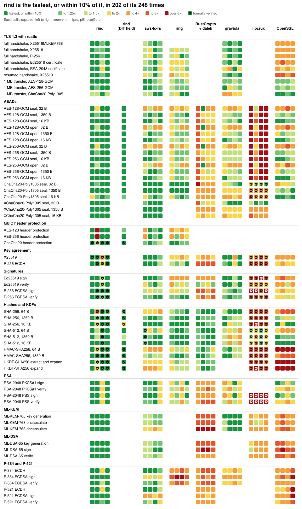
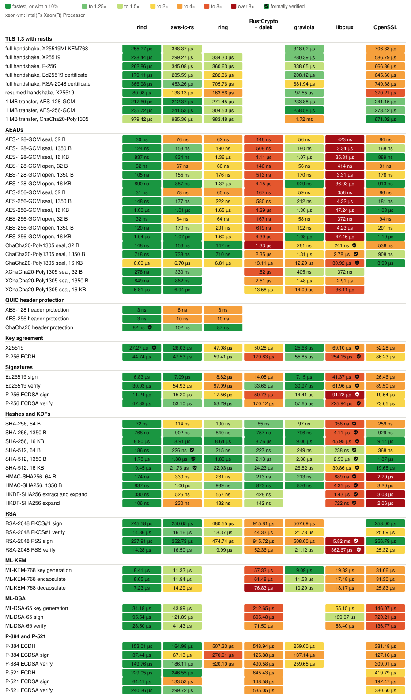
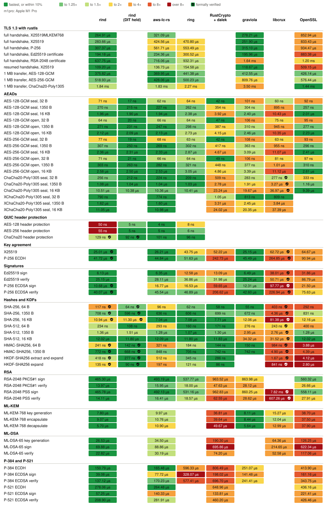
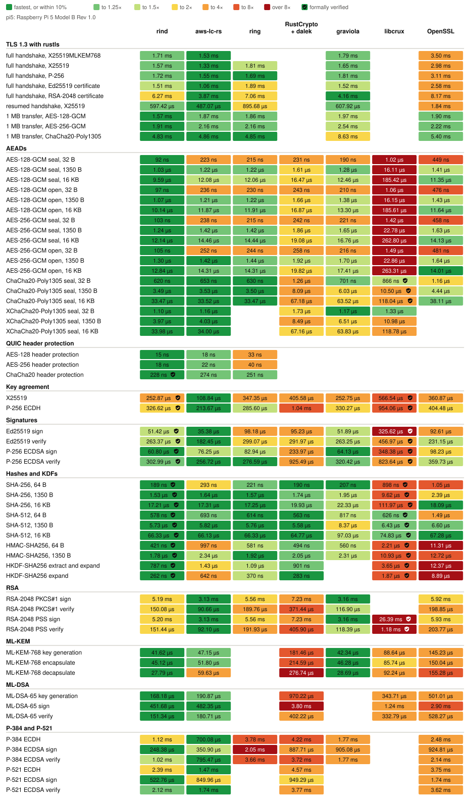
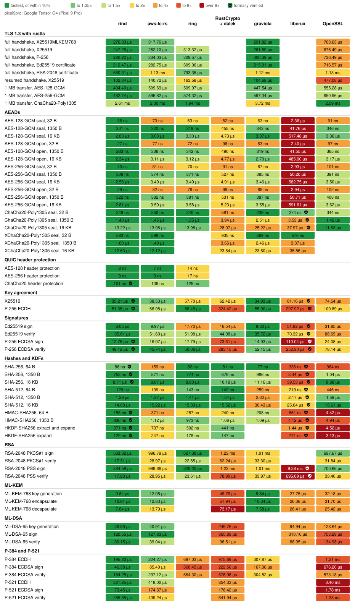

<!-- SPDX-License-Identifier: Apache-2.0 OR ISC OR MIT-0 -->
# rind benchmarks: four more hosts

<!-- Generated by rind's own admin/bench-report renderer (report(), overview_svg(), host_svg()) from hosts/*/*.json. -->

How long rind and the usual Rust crypto libraries take for the same operations, on four machines, and what each costs to build. Every library runs its native path on each host. A ✓ marks an operation whose whole computation a published formal proof covers, as [Verified code](#verified-code) lists.

Results of rind's own benchmark harness (`admin/bench-report`, rind-bench, criterion) at [`b6651423`](https://github.com/moq-dev/rind/commit/b66514238d449fc211d75fd14554301bb690e421) on four hosts the upstream report doesn't cover. `benchmarks/overview-all.svg` puts them beside the six hosts the upstream BENCHMARKS.md publishes (its numbers, from `upstream/rind/benchmarks/data/`, measured 2026-11-06 and 2026-11-07 at older commits). `hosts/<host>/` holds each host's raw JSON in the harness's schema, a trimmed log, and notes. `scripts/` holds the wrapper, the renderer, and the run scripts. An RP2040 was also tried and is not runnable: rind lacks `no_std` (see `hosts/rp2040/`). *Correction (2026-11-12): this is stale for Cortex-M in general. rind-bench `patches/0003` makes rind `no_std` on `target_os = "none"` with an M-profile portable backend; that is what the nRF52840 results run on. With 0003 applied, thumbv6m-none-eabi now gets as far as 3 errors, all in `low/generic/reuse_cache.rs` (`compare_exchange`/`fetch_max` on `AtomicU8`; ARMv6-M has no CAS), so the RP2040 is still not runnable, for that narrower reason.*

ESP32-S3, msi-001, and their charts stay in [results/](results/) and [media/](media/README.md). *Correction (2026-11-12): the first ESP32-S3 set ran its flash at 40 MHz, espflash's default, not the configured 80 MHz, which slowed every cache-missing row by up to 1.9x; [results/RESULTS.md](results/RESULTS.md) is now the 80 MHz rerun, and the old set is in [results/diag/esp32s3-40mhz-2026-11-11/](results/diag/esp32s3-40mhz-2026-11-11/README.md). No gap verdict changed.* *Rerun (2026-11-12): both boards are now at rind [`98568332`](https://github.com/moq-dev/rind/commit/985683329fb98aebfaae6c493f205f20070a8fca), whose Keccak rewrite closes the SHA-3 gap on the ESP32-S3 and the ML-KEM-768 gap on the nRF52840; the 99b509a sets are in [results/diag/](results/diag/). Each board's short-input rows were also run in relinked layouts: [ESP32-S3](results/diag/esp32s3-relink-98568332/README.md), [nRF52840](results/diag/nrf52840-relink-98568332/README.md).* The tables, charts and screenshots under results/ and media/ come from `cargo xtask` (tools/xtask), and `cargo verify` (tools/verify, which shares no code with it) recomputes every published number from raw. The nRF52840 (a Seeed T1000-E, Cortex-M4F at 64 MHz, bare metal) is in [results/nrf52840/](results/nrf52840/RESULTS.md): rind builds `no_std` there with rind-bench's `patches/0003`. Bare-metal extras: [EXTRAS.md](EXTRAS.md). The ESP32-S3 ChaCha20-Poly1305/XChaCha20-Poly1305 images first crashed on an LLVM-Xtensa stack-realignment bug hit by ring, not a rind bug; with rind-bench's ring patch they pass on hardware (3 of 3 runs, 2026-11-12): [results/diag/esp32s3-chacha-crash.md](results/diag/esp32s3-chacha-crash.md).

<picture>
  <source media="(prefers-color-scheme: dark)" srcset="benchmarks/overview-all-dark.svg">
  
</picture>

## Hosts

| Host | CPU | OS | Measured |
|---|---|---|---|
| `xeon-vm` | Intel(R) Xeon(R) Processor | Debian GNU/Linux 13 (trixie) (Linux 6.12.113+) | 2026-11-12 at [`b6651423`](https://github.com/moq-dev/rind/commit/b66514238d449fc211d75fd14554301bb690e421) |
| `m1pro` | Apple M1 Pro | macOS 14.0 (23.0.0) | 2026-11-12 at [`b6651423`](https://github.com/moq-dev/rind/commit/b66514238d449fc211d75fd14554301bb690e421), noisy |
| `pi5` | Raspberry Pi 5 Model B Rev 1.0 | Debian GNU/Linux 13 (trixie) (Linux 6.18.60+rpt-rpi-2712) | 2026-11-12 at [`b6651423`](https://github.com/moq-dev/rind/commit/b66514238d449fc211d75fd14554301bb690e421) |
| `pixel9pro` | Google Tensor G4 (Pixel 9 Pro) | Android 17 (API 37, build CP3A.261005.005) | 2026-11-12 at [`b6651423`](https://github.com/moq-dev/rind/commit/b66514238d449fc211d75fd14554301bb690e421), noisy |

Each host ran `admin/bench-report run` (the host side of `collect`) through a small wrapper, `host-run.py`, that keeps its operations, criterion arguments, parsing, and JSON unchanged but records rather than refuses a busy host or a toolchain other than the Nix-pinned one. The Pixel 9 Pro is the exception: its benches were cross-compiled on `xeon-vm` and run over adb with the same criterion arguments and filter, then parsed by `scripts/android-convert.py` the way the harness parses them. Times are criterion's estimates. Dates are UTC. A host marked noisy had other work busy during its run.

## Speed

Each row is one operation and each column one library. Each cell holds a square per host, colored by that library's time over the fastest library's on the same host, as the legend shows. A shield in a square marks verified code. Each square's tooltip, in the SVG opened on its own, gives its time; the tables below each host give them all. A library with no square doesn't offer the operation, or the host didn't time it, as its section says.

rind (DIT held) times rind with `rind::cpu::Dit::hold()` held across the timed loop, as a caller batching calls does, so that DIT is set once rather than around each call. Only an Apple CPU times it, since elsewhere it runs the same code as rind's own column, and it never counts as the fastest library.

<picture>
  <source media="(prefers-color-scheme: dark)" srcset="benchmarks/overview-dark.svg">
  
</picture>

### `xeon-vm`: Intel(R) Xeon(R) Processor

Measured 2026-11-12 at [`b6651423`](https://github.com/moq-dev/rind/commit/b66514238d449fc211d75fd14554301bb690e421), on Debian GNU/Linux 13 (trixie) (Linux 6.12.113+) with rustc 1.98.1 (48a229cea 2026-09-01).

Cloud VM: 8 vCPUs, shared with other agents, so other work ran during the benchmarks; treat small differences as noise.

<picture>
  <source media="(prefers-color-scheme: dark)" srcset="benchmarks/xeon-vm-dark.svg">
  
</picture>

Times on xeon-vm

| Operation | rind | aws-lc-rs | ring | RustCrypto + dalek | graviola | libcrux | OpenSSL |
|---|---|---|---|---|---|---|---|
| full handshake, X25519MLKEM768 | 255.27 µs | 348.37 µs | - | - | 318.02 µs | - | 706.83 µs |
| full handshake, X25519 | 228.44 µs | 299.27 µs | 334.33 µs | - | 280.39 µs | - | 586.79 µs |
| full handshake, P-256 | 262.86 µs | 345.08 µs | 360.63 µs | - | 338.65 µs | - | 666.36 µs |
| full handshake, Ed25519 certificate | 179.11 µs | 235.59 µs | 282.36 µs | - | 208.12 µs | - | 645.60 µs |
| full handshake, RSA-2048 certificate | 366.98 µs | 453.26 µs | 705.76 µs | - | 681.94 µs | - | 749.38 µs |
| resumed handshake, X25519 | 80.08 µs | 138.13 µs | 163.86 µs | - | 97.55 µs | - | 370.21 µs |
| 1 MB transfer, AES-128-GCM | 217.60 µs | 212.37 µs | 271.45 µs | - | 233.88 µs | - | 241.15 µs |
| 1 MB transfer, AES-256-GCM | 235.72 µs | 241.53 µs | 304.50 µs | - | 258.58 µs | - | 273.42 µs |
| 1 MB transfer, ChaCha20-Poly1305 | 979.42 µs | 985.36 µs | 983.48 µs | - | 1.72 ms | - | 671.02 µs |
| AES-128-GCM seal, 32 B | 30 ns | 76 ns | 62 ns | 146 ns | 56 ns | 423 ns | 84 ns |
| AES-128-GCM seal, 1350 B | 124 ns | 153 ns | 190 ns | 508 ns | 180 ns | 3.34 µs | 168 ns |
| AES-128-GCM seal, 16 KB | 837 ns | 834 ns | 1.36 µs | 4.11 µs | 1.07 µs | 35.81 µs | 889 ns |
| AES-128-GCM open, 32 B | 32 ns | 67 ns | 60 ns | 146 ns | 56 ns | 414 ns | 91 ns |
| AES-128-GCM open, 1350 B | 105 ns | 155 ns | 176 ns | 513 ns | 170 ns | 3.31 µs | 176 ns |
| AES-128-GCM open, 16 KB | 890 ns | 887 ns | 1.32 µs | 4.15 µs | 929 ns | 36.03 µs | 913 ns |
| AES-256-GCM seal, 32 B | 31 ns | 78 ns | 65 ns | 167 ns | 59 ns | 356 ns | 86 ns |
| AES-256-GCM seal, 1350 B | 148 ns | 177 ns | 222 ns | 580 ns | 212 ns | 4.32 µs | 181 ns |
| AES-256-GCM seal, 16 KB | 1.00 µs | 1.01 µs | 1.65 µs | 4.29 µs | 1.30 µs | 47.24 µs | 1.08 µs |
| AES-256-GCM open, 32 B | 32 ns | 64 ns | 64 ns | 167 ns | 58 ns | 372 ns | 94 ns |
| AES-256-GCM open, 1350 B | 120 ns | 170 ns | 201 ns | 619 ns | 192 ns | 4.23 µs | 201 ns |
| AES-256-GCM open, 16 KB | 1.04 µs | 1.07 µs | 1.60 µs | 4.39 µs | 1.08 µs | 47.46 µs | 1.10 µs |
| ChaCha20-Poly1305 seal, 32 B | 148 ns | 156 ns | 147 ns | 1.33 µs | 261 ns | 241 ns ✓ | 536 ns |
| ChaCha20-Poly1305 seal, 1350 B | 718 ns | 738 ns | 710 ns | 2.35 µs | 1.31 µs | 2.78 µs ✓ | 908 ns |
| ChaCha20-Poly1305 seal, 16 KB | 6.69 µs | 6.70 µs | 6.81 µs | 13.11 µs | 12.29 µs | 30.92 µs ✓ | 3.99 µs |
| XChaCha20-Poly1305 seal, 32 B | 278 ns | 330 ns | - | 1.52 µs | 405 ns | 372 ns | - |
| XChaCha20-Poly1305 seal, 1350 B | 849 ns | 862 ns | - | 2.51 µs | 1.48 µs | 2.91 µs | - |
| XChaCha20-Poly1305 seal, 16 KB | 6.81 µs | 6.94 µs | - | 13.58 µs | 14.00 µs | 36.11 µs | - |
| AES-128 header protection | 3 ns | 8 ns | 8 ns | - | - | - | - |
| AES-256 header protection | 3 ns | 10 ns | 10 ns | - | - | - | - |
| ChaCha20 header protection | 82 ns ✓ | 102 ns | 87 ns | - | - | - | - |
| X25519 | 27.27 µs ✓ | 26.03 µs | 47.08 µs | 50.28 µs | 25.66 µs | 69.10 µs ✓ | 52.28 µs |
| P-256 ECDH | 44.74 µs | 47.53 µs | 59.41 µs | 179.83 µs | 55.85 µs | 254.15 µs ✓ | 86.23 µs |
| Ed25519 sign | 6.83 µs | 7.09 µs | 18.82 µs | 14.05 µs | 7.15 µs | 41.37 µs ✓ | 26.46 µs |
| Ed25519 verify | 30.03 µs | 54.93 µs | 97.09 µs | 33.66 µs | 30.97 µs | 61.96 µs ✓ | 89.50 µs |
| P-256 ECDSA sign | 11.24 µs | 15.20 µs | 17.56 µs | 50.73 µs | 14.41 µs | 91.78 µs ✓ | 19.64 µs |
| P-256 ECDSA verify | 47.39 µs | 53.10 µs | 53.29 µs | 170.12 µs | 57.65 µs | 225.94 µs ✓ | 73.65 µs |
| SHA-256, 64 B | 72 ns | 114 ns | 100 ns | 85 ns | 97 ns | 358 ns ✓ | 259 ns |
| SHA-256, 1350 B | 768 ns | 902 ns | 840 ns | 757 ns | 796 ns | 4.11 µs ✓ | 929 ns |
| SHA-256, 16 KB | 8.90 µs | 8.91 µs | 8.64 µs | 8.76 µs | 9.00 µs | 45.95 µs ✓ | 9.14 µs |
| SHA-512, 64 B | 186 ns | 226 ns ✓ | 215 ns | 227 ns | 249 ns | 238 ns ✓ | 368 ns |
| SHA-512, 1350 B | 1.78 µs | 1.88 µs ✓ | 1.89 µs | 2.13 µs | 2.38 µs | 2.59 µs ✓ | 1.87 µs |
| SHA-512, 16 KB | 19.45 µs | 21.76 µs ✓ | 22.03 µs | 24.23 µs | 26.82 µs | 30.86 µs ✓ | 19.65 µs |
| HMAC-SHA256, 64 B | 174 ns | 330 ns | 281 ns | 213 ns | 213 ns | 889 ns ✓ | 2.70 µs |
| HMAC-SHA256, 1350 B | 837 ns | 1.06 µs | 939 ns | 873 ns | 876 ns | 4.35 µs ✓ | 3.20 µs |
| HKDF-SHA256 extract and expand | 330 ns | 526 ns | 557 ns | 428 ns | - | 1.43 µs ✓ | 3.03 µs |
| HKDF-SHA256 expand | 106 ns | 230 ns | 182 ns | 142 ns | - | 722 ns ✓ | 2.06 µs |
| RSA-2048 PKCS#1 sign | 245.58 µs | 250.65 µs | 480.55 µs | 915.81 µs | 507.69 µs | - | 253.00 µs |
| RSA-2048 PKCS#1 verify | 14.36 µs | 16.16 µs | 18.37 µs | 44.33 µs | 21.73 µs | - | 25.09 µs |
| RSA-2048 PSS sign | 237.91 µs | 252.73 µs | 474.74 µs | 915.72 µs | 508.60 µs | 5.82 ms ✓ | 256.79 µs |
| RSA-2048 PSS verify | 14.28 µs | 16.50 µs | 19.99 µs | 52.36 µs | 21.12 µs | 362.67 µs ✓ | 25.32 µs |
| ML-KEM-768 key generation | 8.41 µs | 11.33 µs | - | 57.33 µs | 9.09 µs | 19.82 µs | 31.06 µs |
| ML-KEM-768 encapsulate | 8.65 µs | 11.94 µs | - | 61.48 µs | 11.58 µs | 17.48 µs | 31.30 µs |
| ML-KEM-768 decapsulate | 7.23 µs | 14.29 µs | - | 76.83 µs | 10.29 µs | 18.17 µs | 25.83 µs |
| ML-DSA-65 key generation | 34.18 µs | 43.99 µs | - | 212.65 µs | - | 55.15 µs | 146.07 µs |
| ML-DSA-65 sign | 95.54 µs | 121.89 µs | - | 695.48 µs | - | 139.07 µs | 720.21 µs |
| ML-DSA-65 verify | 28.50 µs | 41.43 µs | - | 71.50 µs | - | 58.40 µs | 136.77 µs |
| P-384 ECDH | 153.01 µs | 164.98 µs | 507.33 µs | 548.94 µs | 259.00 µs | - | 381.48 µs |
| P-384 ECDSA sign | 37.44 µs | 67.13 µs | 270.91 µs | 125.88 µs | 137.14 µs | - | 127.16 µs |
| P-384 ECDSA verify | 149.76 µs | 186.11 µs | 520.10 µs | 490.58 µs | 259.65 µs | - | 309.01 µs |
| P-521 ECDH | 229.05 µs | 246.55 µs | - | 645.43 µs | - | - | 419.79 µs |
| P-521 ECDSA sign | 64.41 µs | 133.53 µs | - | 148.58 µs | - | - | 192.47 µs |
| P-521 ECDSA verify | 240.26 µs | 299.72 µs | - | 535.05 µs | - | - | 380.60 µs |

### `m1pro`: Apple M1 Pro

Measured 2026-11-12 at [`b6651423`](https://github.com/moq-dev/rind/commit/b66514238d449fc211d75fd14554301bb690e421), noisy, on macOS 14.0 (23.0.0) with rustc 1.98.0 (88d9e12ae 2026-08-18) (Homebrew).

A MacBook Pro (M1 Pro), in daily use during the run. Its cores have DIT, which rind sets around each call that handles a secret and the other libraries never set. Built with Homebrew's rustc, not the Nix-pinned toolchain.

<picture>
  <source media="(prefers-color-scheme: dark)" srcset="benchmarks/m1pro-dark.svg">
  
</picture>

Times on m1pro

| Operation | rind | rind (DIT held) | aws-lc-rs | ring | RustCrypto + dalek | graviola | libcrux | OpenSSL |
|---|---|---|---|---|---|---|---|---|
| full handshake, X25519MLKEM768 | 264.91 µs | - | 321.09 µs | - | - | 278.21 µs | - | 852.94 µs |
| full handshake, X25519 | 283.66 µs | - | 424.56 µs | 470.80 µs | - | 251.90 µs | - | 833.43 µs |
| full handshake, P-256 | 307.37 µs | - | 561.71 µs | 553.49 µs | - | 315.10 µs | - | 934.47 µs |
| full handshake, Ed25519 certificate | 194.18 µs | - | 234.36 µs | 300.52 µs | - | 195.96 µs | - | 883.38 µs |
| full handshake, RSA-2048 certificate | 637.75 µs | - | 716.06 µs | 932.31 µs | - | 1.64 ms | - | 1.20 ms |
| resumed handshake, X25519 | 109.20 µs | - | 136.73 µs | 154.58 µs | - | 118.67 µs | - | 509.15 µs |
| 1 MB transfer, AES-128-GCM | 375.82 µs | - | 369.95 µs | 441.38 µs | - | 412.55 µs | - | 426.14 µs |
| 1 MB transfer, AES-256-GCM | 518.93 µs | - | 428.06 µs | 500.23 µs | - | 809.76 µs | - | 576.44 µs |
| 1 MB transfer, ChaCha20-Poly1305 | 1.84 ms | - | 1.83 ms | 2.27 ms | - | 3.50 ms | - | 1.44 ms |
| AES-128-GCM seal, 32 B | 71 ns | 17 ns | 62 ns | 64 ns | 42 ns | 101 ns | 60 ns | 92 ns |
| AES-128-GCM seal, 1350 B | 270 ns | 215 ns | 227 ns | 262 ns | 354 ns | 304 ns | 895 ns | 257 ns |
| AES-128-GCM seal, 16 KB | 1.96 µs | 1.90 µs | 1.94 µs | 2.38 µs | 3.92 µs | 2.40 µs | 10.43 µs | 2.01 µs |
| AES-128-GCM open, 32 B | 64 ns | 20 ns | 66 ns | 64 ns | 47 ns | 106 ns | 75 ns | 95 ns |
| AES-128-GCM open, 1350 B | 271 ns | 231 ns | 247 ns | 298 ns | 387 ns | 310 ns | 945 ns | 277 ns |
| AES-128-GCM open, 16 KB | 2.12 µs | 2.09 µs | 2.13 µs | 2.73 µs | 4.15 µs | 2.46 µs | 10.35 µs | 2.23 µs |
| AES-256-GCM seal, 32 B | 77 ns | 19 ns | 68 ns | 63 ns | 42 ns | 108 ns | 63 ns | 93 ns |
| AES-256-GCM seal, 1350 B | 307 ns | 250 ns | 269 ns | 302 ns | 417 ns | 363 ns | 955 ns | 296 ns |
| AES-256-GCM seal, 16 KB | 2.36 µs | 2.31 µs | 2.33 µs | 2.87 µs | 4.67 µs | 3.09 µs | 11.07 µs | 2.41 µs |
| AES-256-GCM open, 32 B | 71 ns | 21 ns | 66 ns | 64 ns | 49 ns | 106 ns | 81 ns | 97 ns |
| AES-256-GCM open, 1350 B | 303 ns | 263 ns | 282 ns | 321 ns | 448 ns | 377 ns | 1.01 µs | 310 ns |
| AES-256-GCM open, 16 KB | 2.58 µs | 2.50 µs | 2.53 µs | 3.05 µs | 4.86 µs | 3.39 µs | 11.12 µs | 2.61 µs |
| ChaCha20-Poly1305 seal, 32 B | 256 ns | 212 ns | 224 ns | 209 ns | 509 ns | 283 ns | 277 ns ✓ | 333 ns |
| ChaCha20-Poly1305 seal, 1350 B | 1.08 µs | 1.04 µs | 1.04 µs | 1.03 µs | 2.78 µs | 1.91 µs | 3.27 µs ✓ | 1.16 µs |
| ChaCha20-Poly1305 seal, 16 KB | 10.51 µs | 10.38 µs | 10.36 µs | 10.41 µs | 23.24 µs | 19.67 µs | 36.97 µs ✓ | 9.39 µs |
| XChaCha20-Poly1305 seal, 32 B | 790 ns | - | 774 ns | - | 1.05 µs | 813 ns | 809 ns | - |
| XChaCha20-Poly1305 seal, 1350 B | 1.62 µs | - | 1.60 µs | - | 3.31 µs | 2.45 µs | 3.84 µs | - |
| XChaCha20-Poly1305 seal, 16 KB | 11.05 µs | - | 10.98 µs | - | 24.02 µs | 20.35 µs | 37.39 µs | - |
| AES-128 header protection | 50 ns | 5 ns | 4 ns | 8 ns | - | - | - | - |
| AES-256 header protection | 55 ns | 5 ns | 5 ns | 6 ns | - | - | - | - |
| ChaCha20 header protection | 129 ns ✓ | 92 ns ✓ | 101 ns | 96 ns | - | - | - | - |
| X25519 | 25.01 µs ✓ | - | 26.21 µs | 43.75 µs | 52.22 µs | 25.15 µs | 62.72 µs ✓ | 64.67 µs |
| P-256 ECDH | 41.72 µs ✓ | - | 44.84 µs | 51.63 µs | 242.73 µs | 45.49 µs | 264.85 µs ✓ | 90.94 µs |
| Ed25519 sign | 6.13 µs | - | 6.35 µs | 12.58 µs | 13.09 µs | 6.49 µs | 38.01 µs ✓ | 31.86 µs |
| Ed25519 verify | 25.15 µs | - | 28.11 µs | 36.86 µs | 31.98 µs | 25.24 µs | 50.71 µs ✓ | 86.79 µs |
| P-256 ECDSA sign | 10.68 µs ✓ | - | 16.77 µs | 16.53 µs | 59.65 µs | 12.31 µs | 97.77 µs ✓ | 21.50 µs |
| P-256 ECDSA verify | 40.07 µs ✓ | - | 45.54 µs | 46.89 µs | 206.62 µs | 42.60 µs | 226.94 µs ✓ | 75.63 µs |
| SHA-256, 64 B | 117 ns ✓ | 64 ns ✓ | 96 ns | 62 ns | 58 ns | 55 ns | 403 ns ✓ | 292 ns |
| SHA-256, 1350 B | 708 ns ✓ | 596 ns ✓ | 636 ns | 606 ns | 699 ns | 672 ns | 4.36 µs ✓ | 831 ns |
| SHA-256, 16 KB | 10.94 µs ✓ | 11.30 µs ✓ | 7.04 µs | 7.08 µs | 7.71 µs | 12.06 µs | 81.38 µs ✓ | 12.16 µs |
| SHA-512, 64 B | 234 ns | 108 ns | 293 ns | 160 ns | 171 ns | 276 ns | 243 ns ✓ | 400 ns |
| SHA-512, 1350 B | 1.36 µs | 1.51 µs | 1.28 µs | 1.07 µs | 1.30 µs | 2.95 µs | 2.76 µs ✓ | 1.28 µs |
| SHA-512, 16 KB | 12.02 µs | 11.80 µs | 12.09 µs | 11.80 µs | 11.83 µs | 34.32 µs | 31.52 µs ✓ | 12.02 µs |
| HMAC-SHA256, 64 B | 241 ns ✓ | 142 ns ✓ | 321 ns | 184 ns | 144 ns | 150 ns | 984 ns ✓ | 3.88 µs |
| HMAC-SHA256, 1350 B | 772 ns ✓ | 668 ns ✓ | 848 ns | 705 ns | 742 ns | 742 ns | 4.90 µs ✓ | 4.39 µs |
| HKDF-SHA256 extract and expand | 418 ns ✓ | 277 ns ✓ | 512 ns | 345 ns | 286 ns | - | 1.67 µs ✓ | 4.12 µs |
| HKDF-SHA256 expand | 135 ns ✓ | 90 ns ✓ | 197 ns | 121 ns | 86 ns | - | 841 ns ✓ | 2.80 µs |
| RSA-2048 PKCS#1 sign | 465.30 µs | - | 493.19 µs | 537.77 µs | 963.52 µs | 863.98 µs | - | 560.32 µs |
| RSA-2048 PKCS#1 verify | 13.97 µs | - | 15.95 µs | 18.00 µs | 47.63 µs | 28.12 µs | - | 26.66 µs |
| RSA-2048 PSS sign | 465.78 µs | - | 492.13 µs | 531.16 µs | 962.83 µs | 860.25 µs | 7.82 ms ✓ | 558.11 µs |
| RSA-2048 PSS verify | 14.11 µs | - | 16.41 µs | 18.57 µs | 62.55 µs | 28.62 µs | 607.26 µs ✓ | 27.91 µs |
| ML-KEM-768 key generation | 7.80 µs | - | 9.97 µs | - | 36.81 µs | 8.11 µs | 15.27 µs | 38.70 µs |
| ML-KEM-768 encapsulate | 9.07 µs | - | 10.76 µs | - | 39.64 µs | 8.44 µs | 12.04 µs | 37.50 µs |
| ML-KEM-768 decapsulate | 5.70 µs | - | 10.90 µs | - | 49.67 µs | 5.64 µs | 12.99 µs | 37.90 µs |
| ML-DSA-65 key generation | 26.53 µs | - | 34.50 µs | - | 190.30 µs | - | 64.36 µs | 126.25 µs |
| ML-DSA-65 sign | 69.88 µs | - | 88.86 µs | - | 695.86 µs | - | 214.65 µs | 622.34 µs |
| ML-DSA-65 verify | 22.82 µs | - | 30.19 µs | - | 74.20 µs | - | 52.58 µs | 117.06 µs |
| P-384 ECDH | 150.79 µs | - | 165.48 µs | 596.33 µs | 806.49 µs | 251.07 µs | - | 413.90 µs |
| P-384 ECDSA sign | 39.08 µs | - | 77.72 µs | 328.07 µs | 198.02 µs | 141.48 µs | - | 161.16 µs |
| P-384 ECDSA verify | 137.12 µs | - | 170.23 µs | 577.41 µs | 696.70 µs | 241.41 µs | - | 343.75 µs |
| P-521 ECDH | 278.06 µs | - | 264.48 µs | - | 648.96 µs | - | - | 436.16 µs |
| P-521 ECDSA sign | 57.25 µs | - | 140.33 µs | - | 133.81 µs | - | - | 221.41 µs |
| P-521 ECDSA verify | 208.90 µs | - | 281.91 µs | - | 460.20 µs | - | - | 426.46 µs |

### `pi5`: Raspberry Pi 5 Model B Rev 1.0

Measured 2026-11-12 at [`b6651423`](https://github.com/moq-dev/rind/commit/b66514238d449fc211d75fd14554301bb690e421), on Debian GNU/Linux 13 (trixie) (Linux 6.18.60+rpt-rpi-2712) with rustc 1.98.1 (48a229cea 2026-09-01).

Raspberry Pi 5 Model B (4× Cortex-A76), reached over ssh through the desktop; idle during the run. System OpenSSL headers unpacked locally, without installing anything.

<picture>
  <source media="(prefers-color-scheme: dark)" srcset="benchmarks/pi5-dark.svg">
  
</picture>

Times on pi5

| Operation | rind | aws-lc-rs | ring | RustCrypto + dalek | graviola | libcrux | OpenSSL |
|---|---|---|---|---|---|---|---|
| full handshake, X25519MLKEM768 | 1.71 ms | 1.53 ms | - | - | 1.79 ms | - | 3.50 ms |
| full handshake, X25519 | 1.57 ms | 1.33 ms | 1.81 ms | - | 1.65 ms | - | 2.98 ms |
| full handshake, P-256 | 1.72 ms | 1.55 ms | 1.69 ms | - | 1.81 ms | - | 3.11 ms |
| full handshake, Ed25519 certificate | 1.51 ms | 1.06 ms | 1.89 ms | - | 1.52 ms | - | 2.58 ms |
| full handshake, RSA-2048 certificate | 6.27 ms | 3.87 ms | 7.06 ms | - | 4.16 ms | - | 8.17 ms |
| resumed handshake, X25519 | 597.42 µs | 487.07 µs | 895.68 µs | - | 607.92 µs | - | 1.84 ms |
| 1 MB transfer, AES-128-GCM | 1.57 ms | 1.87 ms | 1.86 ms | - | 1.97 ms | - | 1.90 ms |
| 1 MB transfer, AES-256-GCM | 1.91 ms | 2.16 ms | 2.16 ms | - | 2.54 ms | - | 2.22 ms |
| 1 MB transfer, ChaCha20-Poly1305 | 4.83 ms | 4.86 ms | 4.85 ms | - | 8.63 ms | - | 5.40 ms |
| AES-128-GCM seal, 32 B | 92 ns | 223 ns | 215 ns | 231 ns | 190 ns | 1.02 µs | 449 ns |
| AES-128-GCM seal, 1350 B | 1.03 µs | 1.22 µs | 1.22 µs | 1.61 µs | 1.28 µs | 16.11 µs | 1.41 µs |
| AES-128-GCM seal, 16 KB | 9.59 µs | 12.08 µs | 12.06 µs | 16.47 µs | 12.46 µs | 185.42 µs | 11.35 µs |
| AES-128-GCM open, 32 B | 97 ns | 236 ns | 230 ns | 243 ns | 210 ns | 1.06 µs | 476 ns |
| AES-128-GCM open, 1350 B | 1.07 µs | 1.21 µs | 1.22 µs | 1.66 µs | 1.38 µs | 16.15 µs | 1.43 µs |
| AES-128-GCM open, 16 KB | 10.14 µs | 11.87 µs | 11.91 µs | 16.87 µs | 13.30 µs | 185.61 µs | 11.64 µs |
| AES-256-GCM seal, 32 B | 103 ns | 238 ns | 215 ns | 242 ns | 221 ns | 1.42 µs | 458 ns |
| AES-256-GCM seal, 1350 B | 1.24 µs | 1.42 µs | 1.42 µs | 1.86 µs | 1.65 µs | 22.78 µs | 1.63 µs |
| AES-256-GCM seal, 16 KB | 12.14 µs | 14.46 µs | 14.44 µs | 19.08 µs | 16.76 µs | 262.80 µs | 14.13 µs |
| AES-256-GCM open, 32 B | 105 ns | 252 ns | 244 ns | 258 ns | 216 ns | 1.49 µs | 481 ns |
| AES-256-GCM open, 1350 B | 1.30 µs | 1.42 µs | 1.44 µs | 1.92 µs | 1.70 µs | 22.86 µs | 1.64 µs |
| AES-256-GCM open, 16 KB | 12.84 µs | 14.31 µs | 14.31 µs | 19.82 µs | 17.41 µs | 263.31 µs | 14.01 µs |
| ChaCha20-Poly1305 seal, 32 B | 620 ns | 653 ns | 630 ns | 1.26 µs | 701 ns | 866 ns ✓ | 1.16 µs |
| ChaCha20-Poly1305 seal, 1350 B | 3.49 µs | 3.53 µs | 3.50 µs | 8.09 µs | 6.03 µs | 10.50 µs ✓ | 4.44 µs |
| ChaCha20-Poly1305 seal, 16 KB | 33.47 µs | 33.52 µs | 33.47 µs | 67.18 µs | 63.52 µs | 118.04 µs ✓ | 38.11 µs |
| XChaCha20-Poly1305 seal, 32 B | 1.10 µs | 1.16 µs | - | 1.73 µs | 1.17 µs | 1.33 µs | - |
| XChaCha20-Poly1305 seal, 1350 B | 3.97 µs | 4.03 µs | - | 8.49 µs | 6.51 µs | 10.98 µs | - |
| XChaCha20-Poly1305 seal, 16 KB | 33.98 µs | 34.00 µs | - | 67.16 µs | 63.83 µs | 118.78 µs | - |
| AES-128 header protection | 15 ns | 18 ns | 33 ns | - | - | - | - |
| AES-256 header protection | 18 ns | 22 ns | 40 ns | - | - | - | - |
| ChaCha20 header protection | 228 ns ✓ | 274 ns | 251 ns | - | - | - | - |
| X25519 | 252.87 µs ✓ | 108.84 µs | 347.35 µs | 405.58 µs | 252.75 µs | 566.54 µs ✓ | 360.87 µs |
| P-256 ECDH | 326.62 µs ✓ | 213.67 µs | 285.60 µs | 1.04 ms | 330.27 µs | 954.06 µs ✓ | 404.48 µs |
| Ed25519 sign | 51.42 µs ✓ | 35.38 µs | 98.18 µs | 95.23 µs | 51.89 µs | 325.62 µs ✓ | 92.61 µs |
| Ed25519 verify | 263.37 µs ✓ | 182.45 µs | 299.07 µs | 291.97 µs | 263.25 µs | 456.97 µs ✓ | 231.15 µs |
| P-256 ECDSA sign | 60.80 µs ✓ | 76.25 µs | 82.94 µs | 233.97 µs | 64.13 µs | 348.38 µs ✓ | 98.23 µs |
| P-256 ECDSA verify | 302.99 µs ✓ | 256.72 µs | 276.59 µs | 925.49 µs | 320.42 µs | 823.64 µs ✓ | 359.73 µs |
| SHA-256, 64 B | 189 ns ✓ | 293 ns | 221 ns | 190 ns | 207 ns | 898 ns ✓ | 1.05 µs |
| SHA-256, 1350 B | 1.53 µs ✓ | 1.64 µs | 1.57 µs | 1.74 µs | 1.95 µs | 9.62 µs ✓ | 2.39 µs |
| SHA-256, 16 KB | 17.21 µs ✓ | 17.31 µs | 17.25 µs | 19.93 µs | 22.33 µs | 111.97 µs ✓ | 18.09 µs |
| SHA-512, 64 B | 578 ns ✓ | 693 ns | 614 ns | 563 ns | 817 ns | 626 ns ✓ | 1.49 µs |
| SHA-512, 1350 B | 5.73 µs ✓ | 5.82 µs | 5.76 µs | 5.58 µs | 8.37 µs | 6.43 µs ✓ | 6.60 µs |
| SHA-512, 16 KB | 66.33 µs ✓ | 66.13 µs | 66.33 µs | 64.77 µs | 97.03 µs | 74.83 µs ✓ | 67.28 µs |
| HMAC-SHA256, 64 B | 421 ns ✓ | 997 ns | 581 ns | 494 ns | 560 ns | 2.21 µs ✓ | 11.31 µs |
| HMAC-SHA256, 1350 B | 1.78 µs ✓ | 2.34 µs | 1.92 µs | 2.05 µs | 2.31 µs | 10.93 µs ✓ | 12.72 µs |
| HKDF-SHA256 extract and expand | 787 ns ✓ | 1.43 µs | 1.09 µs | 901 ns | - | 3.65 µs ✓ | 12.37 µs |
| HKDF-SHA256 expand | 262 ns ✓ | 642 ns | 370 ns | 283 ns | - | 1.87 µs ✓ | 8.89 µs |
| RSA-2048 PKCS#1 sign | 5.19 ms | 3.13 ms | 5.56 ms | 7.23 ms | 3.16 ms | - | 5.92 ms |
| RSA-2048 PKCS#1 verify | 150.08 µs | 90.66 µs | 189.76 µs | 371.44 µs | 116.90 µs | - | 198.85 µs |
| RSA-2048 PSS sign | 5.20 ms | 3.13 ms | 5.56 ms | 7.23 ms | 3.16 ms | 26.39 ms ✓ | 5.93 ms |
| RSA-2048 PSS verify | 151.44 µs | 92.10 µs | 191.93 µs | 405.90 µs | 118.39 µs | 1.18 ms ✓ | 203.77 µs |
| ML-KEM-768 key generation | 41.62 µs | 47.15 µs | - | 181.46 µs | 42.34 µs | 88.64 µs | 145.23 µs |
| ML-KEM-768 encapsulate | 45.12 µs | 51.80 µs | - | 214.59 µs | 46.28 µs | 85.74 µs | 150.04 µs |
| ML-KEM-768 decapsulate | 27.79 µs | 59.63 µs | - | 276.74 µs | 28.69 µs | 92.24 µs | 155.28 µs |
| ML-DSA-65 key generation | 168.18 µs | 190.87 µs | - | 970.22 µs | - | 343.71 µs | 501.01 µs |
| ML-DSA-65 sign | 451.68 µs | 482.35 µs | - | 3.80 ms | - | 1.24 ms | 2.90 ms |
| ML-DSA-65 verify | 151.34 µs | 180.71 µs | - | 402.22 µs | - | 332.79 µs | 528.27 µs |
| P-384 ECDH | 1.12 ms | 700.08 µs | 3.78 ms | 4.22 ms | 1.77 ms | - | 2.48 ms |
| P-384 ECDSA sign | 248.38 µs | 350.90 µs | 2.05 ms | 887.71 µs | 905.08 µs | - | 924.81 µs |
| P-384 ECDSA verify | 1.02 ms | 795.47 µs | 3.66 ms | 3.72 ms | 1.77 ms | - | 2.14 ms |
| P-521 ECDH | 2.39 ms | 1.47 ms | - | 4.57 ms | - | - | 3.75 ms |
| P-521 ECDSA sign | 522.76 µs | 849.96 µs | - | 949.29 µs | - | - | 1.74 ms |
| P-521 ECDSA verify | 2.12 ms | 1.74 ms | - | 3.77 ms | - | - | 3.62 ms |

### `pixel9pro`: Google Tensor G4 (Pixel 9 Pro)

Measured 2026-11-12 at [`b6651423`](https://github.com/moq-dev/rind/commit/b66514238d449fc211d75fd14554301bb690e421), noisy, on Android 17 (API 37, build CP3A.261005.005) with rustc 1.98.1 (48a229cea 2026-09-01).

Pixel 9 Pro (Google Tensor G4: 1× Cortex-X4, 3× A720, 4× A520), Android 17, charging, over adb from the desktop. The benches were cross-compiled on the box for aarch64-linux-android (NDK r28c, rustc 1.98.1) with OpenSSL vendored (openssl-src, static) since Android has no system OpenSSL, and run with the harness's criterion arguments and filter. Marked noisy: the scheduler could move the benchmark between core types, and the battery warmed from 24.7 to 37.7 °C. rind-bench times the DIT-held column only on Apple targets, so it is absent here. No build cost: nothing was built on the phone.

<picture>
  <source media="(prefers-color-scheme: dark)" srcset="benchmarks/pixel9pro-dark.svg">
  
</picture>

Times on pixel9pro

| Operation | rind | aws-lc-rs | ring | RustCrypto + dalek | graviola | libcrux | OpenSSL |
|---|---|---|---|---|---|---|---|
| full handshake, X25519MLKEM768 | 276.33 µs | 317.76 µs | - | - | 291.82 µs | - | 763.63 µs |
| full handshake, X25519 | 247.26 µs | 282.10 µs | 313.32 µs | - | 261.59 µs | - | 676.49 µs |
| full handshake, P-256 | 280.22 µs | 334.03 µs | 309.57 µs | - | 306.39 µs | - | 736.49 µs |
| full handshake, Ed25519 certificate | 212.47 µs | 282.75 µs | 309.06 µs | - | 215.91 µs | - | 716.57 µs |
| full handshake, RSA-2048 certificate | 680.31 µs | 1.13 ms | 793.35 µs | - | 1.12 ms | - | 1.18 ms |
| resumed handshake, X25519 | 102.34 µs | 140.72 µs | 163.58 µs | - | 104.68 µs | - | 477.08 µs |
| 1 MB transfer, AES-128-GCM | 404.40 µs | 509.69 µs | 509.07 µs | - | 447.54 µs | - | 555.28 µs |
| 1 MB transfer, AES-256-GCM | 482.74 µs | 596.82 µs | 574.32 µs | - | 597.34 µs | - | 650.96 µs |
| 1 MB transfer, ChaCha20-Poly1305 | 2.61 ms | 2.00 ms | 1.94 ms | - | 3.72 ms | - | 2.09 ms |
| AES-128-GCM seal, 32 B | 36 ns | 73 ns | 63 ns | 82 ns | 63 ns | 2.36 µs | 91 ns |
| AES-128-GCM seal, 1350 B | 301 ns | 320 ns | 319 ns | 455 ns | 343 ns | 41.76 µs | 346 ns |
| AES-128-GCM seal, 16 KB | 2.83 µs | 3.03 µs | 3.30 µs | 4.73 µs | 3.07 µs | 517.48 µs | 3.36 µs |
| AES-128-GCM open, 32 B | 27 ns | 77 ns | 72 ns | 96 ns | 63 ns | 2.40 µs | 97 ns |
| AES-128-GCM open, 1350 B | 283 ns | 336 ns | 342 ns | 490 ns | 319 ns | 41.55 µs | 365 ns |
| AES-128-GCM open, 16 KB | 2.34 µs | 3.11 µs | 3.12 µs | 4.77 µs | 2.70 µs | 485.00 µs | 3.17 µs |
| AES-256-GCM seal, 32 B | 40 ns | 81 ns | 70 ns | 91 ns | 67 ns | 2.93 µs | 101 ns |
| AES-256-GCM seal, 1350 B | 308 ns | 374 ns | 371 ns | 527 ns | 385 ns | 50.20 µs | 391 ns |
| AES-256-GCM seal, 16 KB | 2.56 µs | 3.49 µs | 3.49 µs | 4.91 µs | 3.46 µs | 582.75 µs | 3.50 µs |
| AES-256-GCM open, 32 B | 29 ns | 82 ns | 76 ns | 99 ns | 65 ns | 2.94 µs | 102 ns |
| AES-256-GCM open, 1350 B | 322 ns | 382 ns | 381 ns | 531 ns | 387 ns | 50.71 µs | 408 ns |
| AES-256-GCM open, 16 KB | 2.81 µs | 3.59 µs | 3.58 µs | 5.23 µs | 3.55 µs | 591.61 µs | 3.62 µs |
| ChaCha20-Poly1305 seal, 32 B | 249 ns | 250 ns | 240 ns | 581 ns | 239 ns | 274 ns ✓ | 344 ns |
| ChaCha20-Poly1305 seal, 1350 B | 1.43 µs | 1.45 µs | 1.35 µs | 3.94 µs | 2.51 µs | 3.53 µs ✓ | 1.42 µs |
| ChaCha20-Poly1305 seal, 16 KB | 13.22 µs | 13.98 µs | 13.98 µs | 28.07 µs | 25.22 µs | 37.97 µs ✓ | 11.63 µs |
| XChaCha20-Poly1305 seal, 32 B | 593 ns | 598 ns | - | 935 ns | 569 ns | 576 ns | - |
| XChaCha20-Poly1305 seal, 1350 B | 1.60 µs | 1.49 µs | - | 3.66 µs | 2.46 µs | 3.37 µs | - |
| XChaCha20-Poly1305 seal, 16 KB | 12.63 µs | 12.12 µs | - | 23.84 µs | 23.80 µs | 35.86 µs | - |
| AES-128 header protection | 8 ns | 7 ns | 14 ns | - | - | - | - |
| AES-256 header protection | 9 ns | 9 ns | 17 ns | - | - | - | - |
| ChaCha20 header protection | 101 ns ✓ | 136 ns | 125 ns | - | - | - | - |
| X25519 | 35.21 µs ✓ | 38.53 µs | 57.70 µs | 62.42 µs | 34.93 µs | 81.16 µs ✓ | 74.54 µs |
| P-256 ECDH | 51.38 µs ✓ | 66.98 µs | 56.45 µs | 324.42 µs | 55.90 µs | 297.92 µs ✓ | 100.89 µs |
| Ed25519 sign | 8.05 µs | 9.97 µs | 17.70 µs | 16.54 µs | 8.30 µs | 51.82 µs ✓ | 31.85 µs |
| Ed25519 verify | 35.61 µs | 51.60 µs | 51.98 µs | 44.08 µs | 35.72 µs | 70.32 µs ✓ | 88.65 µs |
| P-256 ECDSA sign | 12.76 µs ✓ | 16.97 µs | 17.79 µs | 73.61 µs | 14.93 µs | 110.04 µs ✓ | 24.08 µs |
| P-256 ECDSA verify | 49.12 µs ✓ | 45.74 µs | 50.06 µs | 283.15 µs | 52.15 µs | 252.90 µs ✓ | 78.14 µs |
| SHA-256, 64 B | 86 ns ✓ | 159 ns | 82 ns | 81 ns | 77 ns | 336 ns ✓ | 364 ns |
| SHA-256, 1350 B | 753 ns ✓ | 871 ns | 774 ns | 876 ns | 966 ns | 3.44 µs ✓ | 1.04 µs |
| SHA-256, 16 KB | 8.71 µs ✓ | 8.87 µs | 8.80 µs | 10.18 µs | 11.16 µs | 39.53 µs ✓ | 8.88 µs |
| SHA-512, 64 B | 129 ns | 199 ns | 143 ns | 142 ns | 259 ns | 219 ns ✓ | 446 ns |
| SHA-512, 1350 B | 1.29 µs | 1.37 µs | 1.41 µs | 1.34 µs | 2.62 µs | 2.17 µs ✓ | 1.59 µs |
| SHA-512, 16 KB | 14.68 µs | 15.22 µs | 15.39 µs | 15.52 µs | 30.43 µs | 25.04 µs ✓ | 15.61 µs |
| HMAC-SHA256, 64 B | 158 ns ✓ | 371 ns | 257 ns | 240 ns | 208 ns | 861 ns ✓ | 4.42 µs |
| HMAC-SHA256, 1350 B | 836 ns ✓ | 1.12 µs | 973 ns | 1.06 µs | 1.09 µs | 4.12 µs ✓ | 4.94 µs |
| HKDF-SHA256 extract and expand | 371 ns ✓ | 707 ns | 502 ns | 441 ns | - | 1.44 µs ✓ | 4.52 µs |
| HKDF-SHA256 expand | 129 ns ✓ | 247 ns | 178 ns | 147 ns | - | 771 ns ✓ | 3.13 µs |
| RSA-2048 PKCS#1 sign | 583.32 µs | 996.79 µs | 627.38 µs | 1.23 ms | 1.01 ms | - | 697.67 µs |
| RSA-2048 PKCS#1 verify | 17.31 µs | 28.97 µs | 22.85 µs | 62.24 µs | 33.30 µs | - | 31.84 µs |
| RSA-2048 PSS sign | 584.58 µs | 998.66 µs | 628.25 µs | 1.23 ms | 1.01 ms | 9.38 ms ✓ | 700.66 µs |
| RSA-2048 PSS verify | 17.23 µs | 28.95 µs | 23.61 µs | 78.90 µs | 33.97 µs | 696.09 µs ✓ | 33.40 µs |
| ML-KEM-768 key generation | 9.84 µs | 12.05 µs | - | 49.76 µs | 9.84 µs | 27.75 µs | 32.18 µs |
| ML-KEM-768 encapsulate | 10.81 µs | 12.83 µs | - | 51.94 µs | 10.34 µs | 26.36 µs | 31.70 µs |
| ML-KEM-768 decapsulate | 7.84 µs | 13.79 µs | - | 73.17 µs | 7.58 µs | 26.41 µs | 25.42 µs |
| ML-DSA-65 key generation | 36.88 µs | 40.91 µs | - | 249.76 µs | - | 94.94 µs | 128.64 µs |
| ML-DSA-65 sign | 120.55 µs | 127.83 µs | - | 865.89 µs | - | 310.16 µs | 753.29 µs |
| ML-DSA-65 verify | 30.15 µs | 39.04 µs | - | 96.51 µs | - | 88.95 µs | 134.98 µs |
| P-384 ECDH | 195.20 µs | 224.27 µs | 697.03 µs | 975.69 µs | 307.87 µs | - | 1.31 ms |
| P-384 ECDSA sign | 46.38 µs | 85.40 µs | 368.45 µs | 222.56 µs | 167.06 µs | - | 676.20 µs |
| P-384 ECDSA verify | 184.25 µs | 237.12 µs | 664.30 µs | 876.98 µs | 304.52 µs | - | 573.18 µs |
| P-521 ECDH | 321.25 µs | 418.00 µs | - | 854.33 µs | - | - | 3.40 ms |
| P-521 ECDSA sign | 73.45 µs | 174.37 µs | - | 178.42 µs | - | - | 1.78 ms |
| P-521 ECDSA verify | 285.88 µs | 439.24 µs | - | 641.94 µs | - | - | 1.38 ms |

## Build cost

A cold `cargo build --release` of a minimal binary per library (AES-128-GCM, SHA-256, ECDSA P-256, and X25519) and of a rustls client per provider, by `admin/build-cost`: the median of three builds with an empty target directory and a warm download cache, their CPU time, the stripped binary's size, the build tools it needs beyond rustc and a linker, and the crates it compiles. The system OpenSSL build leaves the library itself out of its size; the vendored build is the static figure.

### `xeon-vm`

Measured 2026-11-12 at [`b6651423`](https://github.com/moq-dev/rind/commit/b66514238d449fc211d75fd14554301bb690e421), with rustc 1.98.1 (48a229cea 2026-09-01), gcc (GCC) 16.2.0, and 8 jobs.

| Build | Wall s (range) | CPU s | Stripped MB | Tools needed | Crates |
|---|---|---|---|---|---|
| rind | 6.9 (6.8 to 7.2) | 14 | 0.89 | none | 5 |
| aws-lc-rs | 19.4 (19.2 to 19.6) | 51 | 2.99 | cc | 14 |
| ring | 8.0 (7.8 to 8.1) | 11 | 0.74 | cc | 9 |
| RustCrypto + dalek | 4.3 (4.3 to 4.5) | 21 | 0.54 | none | 57 |
| graviola | 3.2 (3.1 to 3.2) | 6 | 0.91 | none | 5 |
| libcrux | 12.5 (8.1 to 14.9) | 22 | 0.75 | none | 27 |
| OpenSSL, the system's, linked dynamically | 5.3 (5.3 to 5.8) | 12 | 0.38 | cc, pkg-config | 18 |
| OpenSSL, vendored | 34.4 (34.2 to 37.9) | 191 | 5.13 | cc, make, perl | 19 |
| rustls + rind-rustls | 7.9 (7.6 to 8.2) | 34 | 3.00 | none | 14 |
| rustls + aws-lc-rs | 26.8 (26.4 to 30.5) | 77 | 4.11 | cc | 20 |
| rustls + ring | 12.8 (12.6 to 12.9) | 29 | 1.93 | cc | 16 |

### `m1pro`

Not measured: error: host is busy (10.1 of 10 CPUs busy)

### `pi5`

Measured 2026-11-12 at [`b6651423`](https://github.com/moq-dev/rind/commit/b66514238d449fc211d75fd14554301bb690e421), with rustc 1.98.1 (48a229cea 2026-09-01), cc (Debian 14.2.0-19) 14.2.0, and 4 jobs.

| Build | Wall s (range) | CPU s | Stripped MB | Tools needed | Crates |
|---|---|---|---|---|---|
| rind | 15.6 (15.5 to 15.6) | 34 | 0.73 | none | 5 |
| aws-lc-rs | 54.9 (54.8 to 55.0) | 135 | 1.97 | cc | 14 |
| ring | 18.5 (18.4 to 18.5) | 28 | 0.66 | cc | 9 |
| RustCrypto + dalek | 19.6 (19.5 to 19.6) | 68 | 0.49 | none | 52 |
| graviola | 9.5 (9.5 to 9.5) | 21 | 0.86 | none | 5 |
| libcrux | 26.9 (26.9 to 27.0) | 60 | 0.59 | none | 27 |
| OpenSSL, the system's, linked dynamically | 15.4 (15.4 to 15.6) | 37 | 0.40 | cc | 18 |
| OpenSSL, vendored | 140.0 (135.6 to 144.7) | 471 | 4.55 | cc, make, perl | 19 |
| rustls + rind-rustls | 31.4 (31.0 to 31.5) | 110 | 2.17 | none | 14 |
| rustls + aws-lc-rs | 77.2 (77.1 to 77.4) | 207 | 2.95 | cc | 20 |
| rustls + ring | 38.8 (38.8 to 38.8) | 92 | 1.64 | cc | 16 |

### `pixel9pro`

Not measured: not measured: the binaries were cross-compiled on another host

## Gaps on these hosts

Each operation where another library is more than 10% faster than rind on one of these hosts, computed as `admin/bench-report` computes gaps. These are measurements only; `upstream/rind/benchmarks/gaps.toml` holds the maintainers' decisions for its own hosts.

| Operation | On | rind's time over the fastest |
|---|---|---|
| ChaCha20-Poly1305 seal, 16 KB | `xeon-vm` | 1.67× (OpenSSL) |
| 1 MB transfer, ChaCha20-Poly1305 | `xeon-vm` | 1.46× (OpenSSL) |
| AES-128 header protection | `m1pro` | 11.98× (aws-lc-rs) |
| AES-256 header protection | `m1pro` | 10.97× (aws-lc-rs) |
| SHA-256, 64 B | `m1pro` | 2.11× (graviola) |
| AES-256-GCM seal, 32 B | `m1pro` | 1.82× (RustCrypto + dalek) |
| AES-128-GCM seal, 32 B | `m1pro` | 1.72× (RustCrypto + dalek) |
| HMAC-SHA256, 64 B | `m1pro` | 1.67× (RustCrypto + dalek) |
| HKDF-SHA256 expand | `m1pro` | 1.58× (RustCrypto + dalek) |
| SHA-256, 16 KB | `m1pro` | 1.56× (aws-lc-rs) |
| SHA-512, 64 B | `m1pro` | 1.47× (ring) |
| HKDF-SHA256 extract and expand | `m1pro` | 1.46× (RustCrypto + dalek) |
| AES-256-GCM open, 32 B | `m1pro` | 1.43× (RustCrypto + dalek) |
| AES-128-GCM open, 32 B | `m1pro` | 1.39× (RustCrypto + dalek) |
| ChaCha20 header protection | `m1pro` | 1.35× (ring) |
| 1 MB transfer, ChaCha20-Poly1305 | `m1pro` | 1.28× (OpenSSL) |
| SHA-512, 1350 B | `m1pro` | 1.26× (ring) |
| ChaCha20-Poly1305 seal, 32 B | `m1pro` | 1.22× (ring) |
| 1 MB transfer, AES-256-GCM | `m1pro` | 1.21× (aws-lc-rs) |
| AES-128-GCM seal, 1350 B | `m1pro` | 1.19× (aws-lc-rs) |
| SHA-256, 1350 B | `m1pro` | 1.17× (ring) |
| AES-256-GCM seal, 1350 B | `m1pro` | 1.14× (aws-lc-rs) |
| full handshake, X25519 | `m1pro` | 1.13× (graviola) |
| ChaCha20-Poly1305 seal, 16 KB | `m1pro` | 1.12× (OpenSSL) |
| X25519 | `pi5` | 2.32× (aws-lc-rs) |
| RSA-2048 PKCS#1 sign | `pi5` | 1.66× (aws-lc-rs) |
| RSA-2048 PSS sign | `pi5` | 1.66× (aws-lc-rs) |
| RSA-2048 PKCS#1 verify | `pi5` | 1.66× (aws-lc-rs) |
| RSA-2048 PSS verify | `pi5` | 1.64× (aws-lc-rs) |
| full handshake, RSA-2048 certificate | `pi5` | 1.62× (aws-lc-rs) |
| P-521 ECDH | `pi5` | 1.62× (aws-lc-rs) |
| P-384 ECDH | `pi5` | 1.59× (aws-lc-rs) |
| P-256 ECDH | `pi5` | 1.53× (aws-lc-rs) |
| Ed25519 sign | `pi5` | 1.45× (aws-lc-rs) |
| Ed25519 verify | `pi5` | 1.44× (aws-lc-rs) |
| full handshake, Ed25519 certificate | `pi5` | 1.42× (aws-lc-rs) |
| P-384 ECDSA verify | `pi5` | 1.28× (aws-lc-rs) |
| resumed handshake, X25519 | `pi5` | 1.23× (aws-lc-rs) |
| P-521 ECDSA verify | `pi5` | 1.21× (aws-lc-rs) |
| P-256 ECDSA verify | `pi5` | 1.18× (aws-lc-rs) |
| full handshake, X25519 | `pi5` | 1.18× (aws-lc-rs) |
| full handshake, X25519MLKEM768 | `pi5` | 1.12× (aws-lc-rs) |
| full handshake, P-256 | `pi5` | 1.11× (aws-lc-rs) |
| 1 MB transfer, ChaCha20-Poly1305 | `pixel9pro` | 1.35× (ring) |
| ChaCha20-Poly1305 seal, 16 KB | `pixel9pro` | 1.14× (OpenSSL) |
| SHA-256, 64 B | `pixel9pro` | 1.11× (graviola) |

## Verified code

A ✓ means a published, machine-checked proof shows that all the code computing the operation, as that library runs it on that host, gives the specified result for every input: the cipher and its mode, the hash over every block with its padding, the whole scalar multiplication or exponentiation, and the glue around them, such as clamping, byte conversion, and point encoding. Parsing DER key and signature containers, randomness, and the message hash a signature takes are left out. Proofs of memory safety alone, or of only some of the code, earn no ✓. `upstream/rind/benchmarks/verified.toml` holds this table.

| Library | Operations | Platform | Proof |
|---|---|---|---|
| rind | `x25519-ecdh` | x86_64 | [rind's Lean proof, through Aeneas and a hand model of the function-pointer dispatch Aeneas cannot translate, which assumes each key's dispatch table holds its own curve's functions, the only table rind builds, of its agreement API's X25519 down to s2n-bignum's routines, composed with s2n-bignum's HOL Light proofs of curve25519_x25519, curve25519_x25519base, their _alt forms without BMI2 and ADX, and bignum_eq, of s2n-bignum's own object code, which rind transliterates](https://github.com/moq-dev/rind/blob/main/proofs/Rind/X86_64/X25519.lean) |
| rind | `x25519-ecdh` | aarch64 | [rind's Lean proof, through Aeneas and a hand model of the function-pointer dispatch Aeneas cannot translate, which assumes each key's dispatch table holds its own curve's functions, the only table rind builds, of its agreement API's X25519 down to s2n-bignum's routines, composed with s2n-bignum's HOL Light proofs of curve25519_x25519_alt and curve25519_x25519base_alt, of s2n-bignum's own object code, which rind transliterates, and rind's HOL Light proof of bignum_eq, of the object code rind's build emits](https://github.com/moq-dev/rind/blob/main/proofs/Rind/X86_64/X25519.lean) |
| rind | `sha512/*` | x86_64 with intel, avx, ssse3 without avx2 | [rind's Lean proof, through Aeneas and hand models of the function-pointer dispatch Aeneas cannot translate, of its digest API's SHA-512, padding included, down to aws-lc's sha512_block_data_order_avx, which rind runs only on Intel's CPUs without AVX2, composed with aws-lc-verification's SAW proof of that routine, of aws-lc c21d40da, whose SHA-512 code rind's copy from 91c93a8e keeps](https://github.com/moq-dev/rind/blob/main/proofs/Rind/X86_64/Sha512.lean) |
| rind | `sha512/*` | aarch64 without sha3 | [rind's Lean proof, through Aeneas and hand models of the function-pointer dispatch Aeneas cannot translate, of its digest API's SHA-512, padding included, down to aws-lc's sha512_block_data_order_nohw, which rind runs without the SHA-512 instructions, composed with aws-lc-verification's NSym proof of that routine, with its ArmSpecGap caveat, of aws-lc c21d40da, whose SHA-512 code rind's copy from 91c93a8e keeps](https://github.com/moq-dev/rind/blob/main/proofs/Rind/X86_64/Sha512.lean) |
| rind | `ed25519-sign`, `ed25519-verify` | x86_64 with intel, avx, ssse3 without avx2 | [rind's Lean proof, through Aeneas and a hand model of the function-pointer dispatch Aeneas cannot translate, of its signature API's Ed25519 key loading, signing, and verification, small-order key refusal included, down to s2n-bignum's routines and its SHA-512 down to aws-lc's sha512_block_data_order_avx, which rind runs only on Intel's CPUs without AVX2, composed with s2n-bignum's HOL Light proofs of edwards25519_decode, edwards25519_scalarmulbase, edwards25519_scalarmuldouble, bignum_madd_n25519, their _alt forms without BMI2 and ADX, bignum_mod_n25519, bignum_neg_p25519, bignum_lt, and bignum_eq, of s2n-bignum's own object code, which rind transliterates, and aws-lc-verification's SAW proof of that SHA-512 routine](https://github.com/moq-dev/rind/blob/main/proofs/Rind/X86_64/Ed25519.lean) |
| rind | `ed25519-sign`, `ed25519-verify` | aarch64 without sha3 | [rind's Lean proof, through Aeneas and a hand model of the function-pointer dispatch Aeneas cannot translate, of its signature API's Ed25519 key loading, signing, and verification, small-order key refusal included, down to s2n-bignum's routines and its SHA-512 down to aws-lc's sha512_block_data_order_nohw, which rind runs without the SHA-512 instructions, composed with s2n-bignum's HOL Light proofs of edwards25519_decode_alt, edwards25519_scalarmulbase_alt, edwards25519_scalarmuldouble_alt, bignum_madd_n25519_alt, bignum_mod_n25519, bignum_neg_p25519, and bignum_lt, of s2n-bignum's own object code, which rind transliterates, and rind's HOL Light proof of bignum_eq, of the object code rind's build emits, and aws-lc-verification's NSym proof of that SHA-512 routine, with its ArmSpecGap caveat](https://github.com/moq-dev/rind/blob/main/proofs/Rind/X86_64/Ed25519.lean) |
| rind | `p256-ecdh` | aarch64 | [rind's Lean proof, through Aeneas and hand models of the function-pointer dispatch and of key generation's draws through a dyn RandomSource, which Aeneas cannot translate, of its agreement API's P-256 key generation, public key, and agreement down to s2n-bignum's routines, composed with s2n-bignum's HOL Light proofs of p256_scalarmulbase_alt, p256_scalarmul_alt, bignum_tomont_p256, bignum_demont_p256, bignum_add_p256, bignum_montmul_p256, bignum_montsqr_p256, and bignum_mod_n256_4, of s2n-bignum's own object code, which rind transliterates, and rind's HOL Light proof of bignum_eq, of the object code rind's build emits, with rind's generator table proven to hold the multiples of G that s2n-bignum's proof assumes](https://github.com/moq-dev/rind/blob/main/proofs/Rind/Aarch64/P256.lean) |
| rind | `p256-ecdsa-sign`, `p256-ecdsa-verify` | aarch64 | [rind's Lean proof, through Aeneas and hand models of the function-pointer dispatch and of the nonces' draws through a dyn RandomSource, which Aeneas cannot translate, of its signature API's P-256 ECDSA with SHA-256 and fixed-length signatures, key generation and loading, signing, and verification, down to s2n-bignum's routines, composed with s2n-bignum's HOL Light proofs of p256_scalarmulbase_alt, p256_montjadd_alt, p256_montjdouble_alt, p256_montjmixadd_alt, bignum_inv_p256, bignum_neg_p256, bignum_tomont_p256, bignum_demont_p256, bignum_add_p256, bignum_montmul_p256, bignum_montsqr_p256, bignum_mod_n256_4, bignum_modadd, bignum_montmul, bignum_demont, and bignum_modinv, of s2n-bignum's own object code, which rind transliterates, and rind's HOL Light proof of bignum_eq, of the object code rind's build emits, with the group laws its twin multiplication relies on proven from Mathlib's and the generator's order n proven, assuming HOL Light's P256_GROUP_ELEMENT_ORDER, that a point has order n, only for verification with a parsed public key, and proving a signature right when signing returns, as its nonce loop has no bound](https://github.com/moq-dev/rind/blob/main/proofs/Rind/Aarch64/P256Signature.lean) |
| rind | `sha256/*`, `hmac-sha256/*`, `hkdf-sha256/*` | aarch64 with aes, pmull, sha2 | [rind's Lean proof, through Aeneas and hand models of the function-pointer dispatch and of HKDF-Expand's loop over its info slices, which Aeneas cannot translate, of its digest, HMAC, and HKDF APIs' SHA-256, padding included, down to aws-lc's sha256_block_data_order_hw, which rind runs with the crypto extension, composed with rind's HOL Light proof of that routine, of the object code rind's build emits, against s2n-bignum's FIPS 180-4 spec from awslabs/s2n-bignum#415, unmerged, which rind pins at 79120e64 and proves FIPS 180-4's](https://github.com/moq-dev/rind/blob/main/proofs/Rind/Aarch64/Sha256Hw.lean) |
| rind | `quic-header-protection/chacha20` | x86_64 | [rind's Lean proof, through Aeneas and a hand model of the function-pointer dispatch Aeneas cannot translate, which assumes each key's mask is its own cipher's, the only one rind builds, of its header-protection API's ChaCha20 against RFC 9001 and RFC 8439, HACL*'s rounds included](https://github.com/moq-dev/rind/blob/main/proofs/Rind/X86_64/ChaCha20.lean) |
| rind | `quic-header-protection/chacha20` | aarch64 | [rind's Lean proof, through Aeneas and a hand model of the function-pointer dispatch Aeneas cannot translate, which assumes each key's mask is its own cipher's, the only one rind builds, of its header-protection API's ChaCha20 against RFC 9001 and RFC 8439, HACL*'s rounds included](https://github.com/moq-dev/rind/blob/main/proofs/Rind/X86_64/ChaCha20.lean) |
| rind | `aes128-gcm/*`, `aes128-gcm-open/*`, `aes256-gcm/*`, `aes256-gcm-open/*` | x86_64 with aes, pclmulqdq, ssse3, sse4.1, avx, movbe without vaes | [rind's Lean proof, through Aeneas and hand models of the function-pointer dispatch, of the AES-NI key expansion and block cipher's raw-pointer loads, and of the SIMD intrinsics as Intel's manual defines them, of its AEAD API's AES-GCM key setup, seal, and open, for AAD and messages under 2^32 bytes, down to HACL*'s Vale AES-GCM routines, composed with Vale's F* proofs of Gcm_blocks_stdcall, Gcm_blocks_decrypt_stdcall, and Compute_iv_stdcall, of the code Vale prints at HACL* f557259007db, which rind imports](https://github.com/moq-dev/rind/blob/main/proofs/Rind/X86_64/AesGcm.lean) |
| aws-lc-rs | `sha512/*` | x86_64 with intel, avx, ssse3 | [aws-lc-verification's SAW proof of SHA-512 through EVP_Digest, padding included, over sha512_block_data_order_avx, which aws-lc runs only on Intel; of aws-lc c21d40da, whose SHA-512 code 5.12.0 keeps](https://github.com/awslabs/aws-lc-verification/blob/797302470c1703cbb1a3a6fa98daffef0bfd3d80/SAW/proof/SHA512/verify-SHA512-x86.saw) |
| libcrux | `sha256/*`, `sha512/*` | any architecture | [HACL*'s F* proof of Hacl.Streaming.SHA2's hash_256 and hash_512, compiled to Rust by an unverified step](https://github.com/hacl-star/hacl-star/blob/f557259007db9933442dde10aa995c1b00bd3446/code/streaming/Hacl.Streaming.SHA2.fst) |
| libcrux | `hmac-sha256/*` | any architecture | [HACL*'s F* proof of Hacl.HMAC's compute_sha2_256, compiled to Rust by an unverified step](https://github.com/hacl-star/hacl-star/blob/f557259007db9933442dde10aa995c1b00bd3446/code/hmac/Hacl.HMAC.fst) |
| libcrux | `hkdf-sha256/*` | any architecture | [HACL*'s F* proof of Hacl.HKDF's extract_sha2_256 and expand_sha2_256, compiled to Rust by an unverified step](https://github.com/hacl-star/hacl-star/blob/f557259007db9933442dde10aa995c1b00bd3446/code/hkdf/Hacl.HKDF.fst) |
| libcrux | `chacha20poly1305/*` | any architecture | [HACL*'s F* proof of Hacl.Chacha20Poly1305_32, compiled to Rust by an unverified step](https://github.com/hacl-star/hacl-star/blob/f557259007db9933442dde10aa995c1b00bd3446/code/chacha20poly1305/Hacl.Chacha20Poly1305_32.fst) |
| libcrux | `x25519-ecdh` | any architecture | [HACL*'s F* proof of Hacl.Curve25519_51's secret_to_public and ecdh, compiled to Rust by an unverified step](https://github.com/hacl-star/hacl-star/blob/f557259007db9933442dde10aa995c1b00bd3446/code/curve25519/Hacl.Curve25519_51.fst) |
| libcrux | `ed25519-sign`, `ed25519-verify` | any architecture | [HACL*'s F* proof of Hacl.Ed25519's sign and verify, compiled to Rust by an unverified step](https://github.com/hacl-star/hacl-star/blob/f557259007db9933442dde10aa995c1b00bd3446/code/ed25519/Hacl.Ed25519.fst) |
| libcrux | `p256-ecdh`, `p256-ecdsa-sign`, `p256-ecdsa-verify` | any architecture | [HACL*'s F* proof of Hacl.P256's dh_initiator, dh_responder, ecdsa_sign_p256_sha2, and ecdsa_verif_p256_sha2, compiled to Rust by an unverified step](https://github.com/hacl-star/hacl-star/blob/f557259007db9933442dde10aa995c1b00bd3446/code/ecdsap256/Hacl.P256.fst) |
| libcrux | `rsa2048-pss-sha256-sign`, `rsa2048-pss-sha256-verify` | any architecture | [HACL*'s F* proof of Hacl.RSAPSS's rsapss_skey_sign and rsapss_pkey_verify, signing without the CRT, compiled to Rust by an unverified step](https://github.com/hacl-star/hacl-star/blob/f557259007db9933442dde10aa995c1b00bd3446/code/rsapss/Hacl.RSAPSS.fst) |
