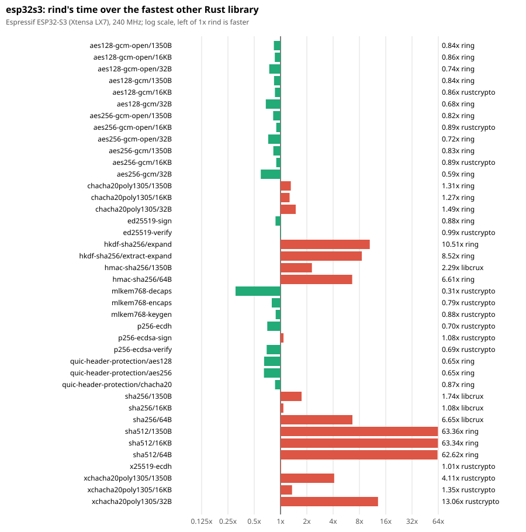
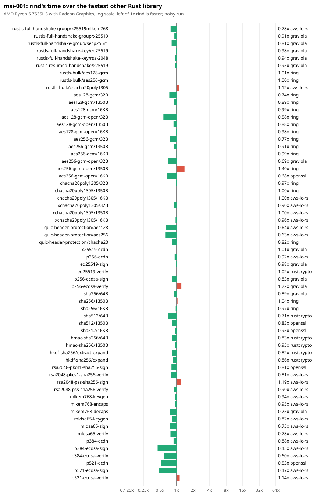
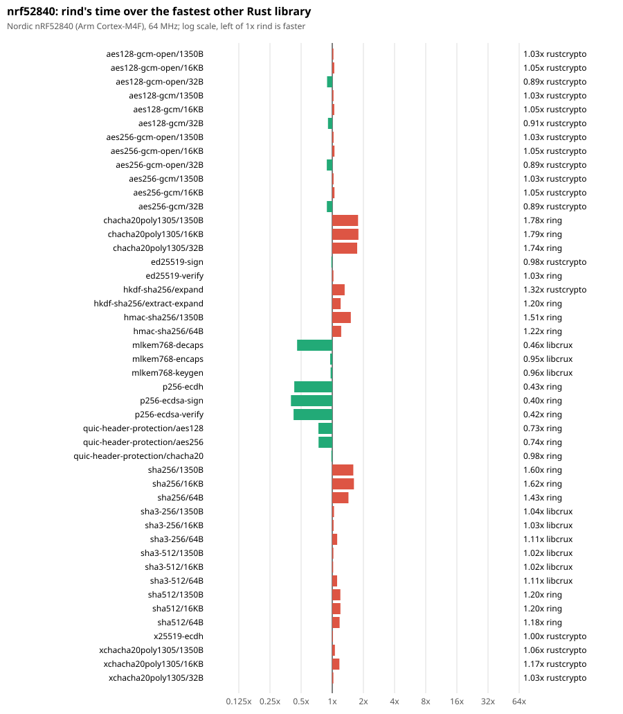
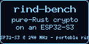
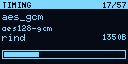
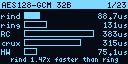
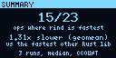

<!-- SPDX-License-Identifier: Apache-2.0 OR ISC OR MIT-0 -->
# Media

Everything here is generated by the tools in [`../tools`](../tools) from the committed results;
home directories, user and host names are replaced in the recordings.

## Charts

rind's time over the fastest other Rust library, per report operation, log scale (`tools/charts.py`):

PNG copies sit next to the SVGs for chat and slides.

## Screenshots

Rendered from the Markdown with `tools/md2png.py` (headless Chrome):

- [ESP32-S3 headline table](screenshots/esp32s3-headline.png)
- [msi-001 summary (rind's `bench-report summary`)](screenshots/msi-001-summary.png)
- [this repo's README](screenshots/rind-results-readme.png), [rind-bench's README](screenshots/rind-bench-readme.png)

## OLED pages

The demo's SSD1306 128x64 pages (I2C0, SDA GPIO5, SCL GPIO6, address 0x3C), rendered on the host by
rind-bench's `demo/oled-ui` (`cargo run --example render`, then `pbm2png.py`) from
`results/demo.tsv`: each page at the panel's native resolution (`@1x`) and 4x (`@4x`). They are
the same drawing code the firmware runs, onto an in-memory frame instead of the panel.

| Page | Native | 4x |
|---|---|---|
| Splash |  | [00-splash@4x.png](oled/00-splash@4x.png) |
| Progress |  | [01-progress@4x.png](oled/01-progress@4x.png) |
| First result page |  | [02-op@4x.png](oled/02-op@4x.png) |
| Summary |  | [25-summary@4x.png](oled/25-summary@4x.png) |

All 26 pages are in [oled/](oled/).

## Terminal recordings

asciinema v2 casts (`asciinema play media/terminal/<name>.cast`) with plain-text copies, made with
`script --log-timing` and `tools/script2cast.py`:

| Recording | What |
|---|---|
| [check](terminal/check.txt) ([cast](terminal/check.cast)) | `scripts/check.sh`: rustfmt and clippy `-D warnings` for all eleven images, the display build and examples, and the display UI |
| [build-flash-run](terminal/build-flash-run.txt) ([cast](terminal/build-flash-run.cast)) | build the `x25519` image, flash it, and capture one full run (it matched the published run within 1.1% on every row) |
| [oled-showcase](terminal/oled-showcase.txt) ([cast](terminal/oled-showcase.cast)) | build and flash the display showcase, and its boot console |

## Serial logs

Every published run's full serial console is in [`../results/raw/<bench>/run-N.log`](../results/raw)
(and the diagnostic runs' in [`../results/diag`](../results/diag)), with the parsed JSON records
beside each. [`serial/x25519-recorded-run.log`](serial/x25519-recorded-run.log) is the run captured in the
recording above. That rebuild's `x25519.elf` hashes to `a22dc0eb…`
([`../results/images-recorded-rebuild.sha256`](../results/images-recorded-rebuild.sha256)), not the
published `f806b1bd…` in [`../results/images.sha256`](../results/images.sha256): it was built after the bench
thread's stack went from 96 KB to 160 KB, and it carries a newer ESP-IDF build timestamp. The published
x25519 rows come from `f806b1bd…`; the rebuild matched them within 1.1% on every row.

The nRF52840 runs' consoles are in [`../results/raw-nrf52840/<bench>/`](../results/raw-nrf52840), and
[`serial/nrf52840-x25519-run-1.log`](serial/nrf52840-x25519-run-1.log) is one of them; the UF2 and ELF hashes of
the images that ran are in [`../results/nrf52840/images.sha256`](../results/nrf52840/images.sha256).
